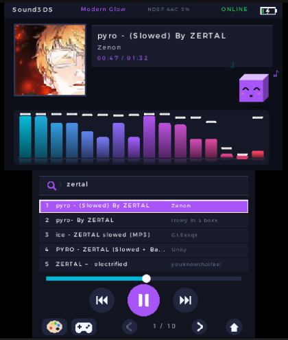

# Sound3DS 🎵

[English](README.md) | **Español**

### Reproductor de Audio Estético para Nintendo 3DS / 2DS (Optimizado para Old 3DS)

**Sound3DS** es un reproductor MP3 y cliente de streaming para Nintendo 3DS/2DS. El objetivo de rendimiento es mantener una interfaz fluida en Old 3DS/2DS; el rendimiento y la salida de audio deben validarse en hardware real.

## 📲 Instalar con QR
<p align="center">
  <a href="https://github.com/PeppiDev/sound3ds/releases/latest/download/sound3ds.cia">
    
  </a>
</p>

En la consola abre **FBI → Remote Install → Scan QR Code** y escanea el código: descarga e instala el `.cia` de la última versión publicada. Al terminar, Sound3DS aparece en el menú HOME. Requiere conexión Wi-Fi y una consola con CFW (Luma3DS).

<p align="center">
  
  <br>
  <em>Reproduciendo «pyro (Slowed) By ZERTAL» en streaming desde SoundCloud</em>
</p>

---

## 🌟 Características Principales

1. **Búsqueda y streaming de SoundCloud**:
   - Búsqueda mediante la API v2 y canciones completas en HLS + AAC (segmentos fMP4), o MP3 progresivo cuando existe.
   - AAC decodificado en la propia consola con Helix AAC (punto fijo, optimizado para ARM); las previews de 30 s se marcan con "30s".
   - Resolución de URL de streaming y redirecciones del proveedor.
   - Búsqueda táctil con integración del teclado virtual del sistema (`swkbd`).
2. **Arquitectura multihilo**:
   - Hilo de audio (decodificación y envío al hardware) con prioridad algo mayor que el hilo principal.
   - Búsqueda, carátula y streaming corren en hilos de red propios; la interfaz sigue animada mientras esperan y cada transferencia se puede cancelar.
   - Todos los hilos usan el núcleo por defecto de la aplicación (Core 0); `APT_SetAppCpuTimeLimit(30)` queda habilitado para pruebas futuras en el Core 1.
3. **Pipeline de audio con dos backends**:
   - Decodificación MP3 con `minimp3` y AAC con Helix AAC, a PCM 16-bit a la frecuencia de la pista.
   - **NDSP** (preferido): cola de 4 buffers sin huecos entre bloques y pausa real. Requiere `sdmc:/3ds/dspfirm.cdc`, que se genera con [DSP1](https://github.com/zoogie/DSP1).
   - **CSND** (respaldo automático si falta `dspfirm.cdc`): anillo PCM en bucle por canal, rellenado por detrás del cabezal de reproducción.
   - La pantalla superior indica qué backend está activo.
4. **Visualizador de Ondas / FFT Reactivo**:
   - Algoritmo de 128 puntos en aritmética entera con tablas de senos/cosenos precomputadas en ROM (<0.04 ms por cuadro).
   - 16 bandas logarítmicas de frecuencias y decaimiento suave de picos (*peak decay*).
5. **Cuenta de SoundCloud y playlists**:
   - Búsqueda de **playlists** (botones Canciones / Playlists junto a la barra): se abren como un álbum y se descargan completas, con una cola que se reanuda si se corta.
   - Con tu cuenta conectada, pestañas **Likes**, **Playlists** (propias y guardadas) y **Feed** (con los reposts marcados).
   - La cuenta se conecta desde el PC con [Sound3DS Share](https://github.com/PeppiDev/sound3ds-share): tu contraseña nunca pasa por la app.
6. **Biblioteca local rápida**: se lee en segundo plano y queda en un índice en la SD, así que después de la primera vez abre al instante aunque tengas cientos de canciones. El álbum **Todas las canciones**, al principio del cover flow, reúne toda la biblioteca.
7. **Aleatorio, repetir y botón de los audífonos**: botones de aleatorio y repetir (no / la lista / la canción), y el botón de los audífonos de cable con micrófono funciona como en el celular (1 toque pausa, 2 siguiente, 3 anterior), incluso con la tapa cerrada.
8. **Motor de Temas Extensible**:
   - **Modern Glow**: Estética cyberpunk/minimalista en modo oscuro con acentos violeta/neón y barras continuas con antialiasing.
   - **Y2K Classic Tunes**: Estilo reproductores de los años 2000 (iTunes clásico / Winamp), con fondo de aluminio cepillado, visor estilo LCD retro fósforo verde y analizador de espectro con segmentos LED discretos (Verde/Amarillo/Rojo).

---

## 🎮 Controles

### Menú principal
- **Pantalla superior**: la mascota, un cubo con ojitos cuadrados que reacciona a lo que haces (y se duerme si no haces nada).
- **Pantalla inferior**: elige **SoundCloud** o **Local** con la cruceta + (A) o tocando la tarjeta. La paleta cambia el tema y la píldora "sonando ahora" lleva a la lista de lo que suena.

### Reproductor (SoundCloud y Local)
- **Pantalla superior**: carátula, título, artista, tiempo, ecualizador y la mascota pequeña.
- **Barra de búsqueda**: en SoundCloud busca; en Local filtra tus canciones (vacío = todas).
- **Lista**: resultados de SoundCloud de a 50 (las listas de la cuenta piden más al llegar al final) y hasta 2000 canciones en Local, en páginas de 5.
- **Pestañas de la cuenta** (con la cuenta conectada): **Buscar · Likes · Playlists · Feed**, bajo la barra de búsqueda. Tocar la pestaña activa o el título recarga la lista.
- **Barra de progreso**: arrastra y suelta para saltar.
- **Transporte**: aleatorio, anterior, reproducir/pausa, siguiente y repetir (no → toda la lista → esta canción). El aleatorio mezcla la lista desde la que estás escuchando (un álbum, una playlist, tus Likes…) sin repetir canciones hasta que suenen todas.
- **Abajo**: paleta de tema, minijuego, descarga (solo SoundCloud), paginador y casa para volver al menú.
- **En Local**, la pantalla de arriba es el cover flow de álbumes y la lista muestra las canciones del álbum enfocado. El primer álbum, **Todas las canciones**, tiene toda tu biblioteca (o lo que coincida con el filtro).

### Botones físicos
- **Cruceta arriba / abajo**: recorrer canciones (o tarjetas en el menú)
- **Cruceta izquierda / derecha**: página anterior / siguiente
- **(A)**: reproducir la canción enfocada, o pausar/reanudar la que suena
- **(B)**: volver al menú
- **(L) / (R)**: pista anterior / siguiente
- **(ZL) / (ZR)** (New 3DS y New 2DS XL): pestaña anterior / siguiente de la cuenta
- **(Y)**: descargar la canción enfocada (SoundCloud)
- **(SELECT)**: alternar tema visual
- **(START)**: salir
- **Volumen**: deslizador físico de la consola

### Configuración
El botón del **engranaje** (en el menú, junto a la paleta, y en el reproductor, junto al de descarga) abre la configuración:
- **Idioma**: inglés (por defecto) o español.
- **LED RGB al reproducir**: el LED de notificación (el de StreetPass) brilla en arcoíris mientras suena música. Funciona en todos los modelos de la familia 3DS.
- **L/R con la tapa cerrada**: **Toque** (1 toque pausa, 2 toques cambian de canción), **Mantener** (mantener L o R 1 segundo cambia de canción y L+R juntos pausa, para que no se aprieten en el bolsillo) o **Desactivados**.
- **Cuenta de SoundCloud**: la cuenta conectada y el botón **Desconectar** (borra la sesión de la SD).
- **Recibir desde el PC**: abre la cámara para escanear el QR de Sound3DS Share (canciones o la cuenta).

Se navega tocando o con la cruceta y **(A)**; **(B)** o la **X** de arriba cierran. Los cambios se guardan en `sdmc:/3ds/sound3ds/settings.ini`.

### Minijuego
El botón del **mando** (junto a la paleta) cambia la pantalla de arriba entre el reproductor y *Cubo vs. Ruido*, sin cortar la música:
- **Analógico**: mover el cubo y esquivar los bloques de ruido (salen más con los graves)
- **(X)**: impulso rápido; mientras dura no te golpean
- **(Y)**: onda expansiva que limpia el ruido cercano (se carga juntando 4 notas)

Tienes tres vidas; al perder se muestran los puntos y el récord, y la partida vuelve a empezar sola. Si lo ocultas, se congela hasta que lo vuelvas a abrir.

### En reposo
Si cierras la tapa (o activas el interruptor de reposo de la 2DS) con música sonando, la app sigue reproduciendo con las pantallas apagadas. El sonido sale por los parlantes, o por los audífonos si están conectados. Por defecto, los controles son un toque de **(L)** o **(R)** para pausar/reanudar, doble toque de **(L)** para la anterior y doble toque de **(R)** para la siguiente (en Configuración se pueden cambiar a *Mantener* o desactivar); al abrirla todo vuelve a la normalidad. Sin música, la consola se suspende como siempre.

### Botón de los audífonos
Los audífonos de cable con micrófono y botón (los típicos de celular) funcionan como en el celular, con la tapa abierta o cerrada:
- **1 toque**: pausa / reanudar
- **2 toques**: siguiente canción
- **3 toques**: canción anterior

### Música local y cover flow
Arrastra tus MP3 a `sdmc:/music/` (o envíalos por Wi-Fi con [Sound3DS Share](#-sound3ds-share-conectar-tu-cuenta-y-pasar-música-desde-el-pc)), sin organizar carpetas: el modo Local los agrupa por **álbum** según sus etiquetas. Antes de copiarlos, ponles los metadatos con [Mp3tag](https://www.mp3tag.de/) o similar:
- **Título**, **Artista**, **Álbum** y **N.º de pista** (el orden dentro del álbum)
- **Artista del álbum** si el disco tiene varios artistas
- **Carátula** embebida (JPEG o PNG): es la que se ve en el cover flow

La pantalla de arriba muestra los álbumes como el cover flow del iPod y la de abajo las canciones del álbum enfocado. **Cruceta izquierda/derecha** (o el analógico) cambia de álbum; **arriba/abajo** y **(A)** eligen la canción. Las canciones sin álbum quedan en "Sin álbum" y, sin etiquetas, el título y el artista salen del nombre `Artista - Título.mp3`.

### Descargar de SoundCloud
En SoundCloud, enfoca una canción y toca el botón con la **flecha** (o pulsa **(Y)**): se descarga a `sdmc:/music/SoundCloud/` en segundo plano, con sus metadatos y carátula, y aparece en el álbum **SoundCloud** del modo Local. Las ya descargadas llevan un ✓. Las que SoundCloud solo ofrece como preview de 30 s no se pueden descargar.

Una **playlist** abierta tiene el botón **Descargar**: baja todas sus canciones a `sdmc:/music/SoundCloud/<playlist>/` y aparece en Local como un álbum con su nombre y carátula. La cola se guarda en la SD: si sales, vas a HOME, se apaga la consola o se corta el Wi-Fi, al volver a abrir Sound3DS pregunta si reanudarla.

### Cuenta de SoundCloud
Para ver tus **likes, playlists y feed** en la consola:

1. En el PC abre [Sound3DS Share](https://github.com/PeppiDev/sound3ds-share) y toca **Conectar SoundCloud**. Se abre la página oficial de SoundCloud: inicia sesión como siempre (también con Google o Apple).
2. Share muestra un QR. En la consola abre **Configuración → Recibir desde el PC** y escanéalo.
3. Listo: aparecen las pestañas **Likes · Playlists · Feed** y tu nombre arriba. La sesión se renueva sola.

**Importante:** Sound3DS guarda tu sesión de SoundCloud en la tarjeta SD. Cualquiera que copie la SD podría usar tu cuenta: no compartas la tarjeta y usa **Desconectar** en Configuración si vas a prestarla o venderla. La app solo **lee** de tu cuenta (no publica, no compra ni cambia nada). No es una integración oficial de SoundCloud: usa la misma API que su web y podría dejar de funcionar si SoundCloud la cambia. Si la sesión vence, solo hay que volver a conectarla.

---

## 📲 Sound3DS Share: conectar tu cuenta y pasar música desde el PC
<p align="center">
  <a href="https://github.com/PeppiDev/sound3ds-share">
    
  </a>
</p>

**[Sound3DS Share](https://github.com/PeppiDev/sound3ds-share)** es la app compañera para el PC (Windows o Linux). **Es necesaria para conectar tu cuenta de SoundCloud** (pasos en [Cuenta de SoundCloud](#cuenta-de-soundcloud)) y además sirve para **llenar el modo Local sin sacar la tarjeta SD**:

1. Abre **Sound3DS Share**, explora tus carpetas y elige canciones. Se agrupan por álbum con su carátula y etiquetas, y puedes corregir lo que falte (álbum, artista, número de pista, carátula) antes de enviar.
2. Toca **Generar QR**.
3. En la consola abre **Configuración → Recibir desde el PC** y escanéalo: las canciones se descargan por Wi-Fi a `sdmc:/music` en segundo plano (sin cortar la música) y aparecen en **Local**, cada una en su álbum del cover flow.

Las descargas e instrucciones de Sound3DS Share están en su repositorio: **https://github.com/PeppiDev/sound3ds-share** (la app Sound3DS QR aparte sigue funcionando, pero ya no hace falta).

---

## 🛠️ Compilación y Ejecución

El proyecto utiliza un contenedor aislado con **Podman** y el toolchain oficial `devkitpro/devkitarm`.

### 1. Compilar el binario `.3dsx`
```bash
./scripts/build.sh
```

### 2. Ejecutar en el emulador Azahar (Citra Fork)
```bash
./scripts/run_azahar.sh
```

### 3. Probar en el PC el camino HLS/AAC
```bash
tests/host/run.sh <carpeta con playlist.m3u8, init.mp4 y seg0.m4s, seg1.m4s...>
```
Compila el demuxer y Helix AAC para el PC, decodifica los segmentos y compara el resultado con ffmpeg (debe superar 40 dB de SNR).

### 4. Generar el `.cia`
```bash
./scripts/build_cia.sh
```
Necesita en el equipo `makerom` ([Project_CTR](https://github.com/3DSGuy/Project_CTR)) y `bannertool`; por defecto los busca en `~/.local/share/3ds-tools/` (se pueden indicar con `MAKEROM=` y `BANNERTOOL=`). El ícono, el banner y su sonido están en `cia/`.

### 5. Instalar en tu consola física (Old 3DS / 2DS / New 3DS)
- **Como `.cia`**: sirve el archivo con un servidor local (por ejemplo `serve_cia.py`) y, en FBI, usa *Remote Install → Scan QR Code*. Queda en el menú HOME.
- **Como `.3dsx`**: copia `sound3ds.3dsx` y `sound3ds.smdh` a `sdmc:/3ds/sound3ds/` y ábrelo desde el **Homebrew Launcher**.

Los binarios no se guardan en el repositorio; cada versión se publica en GitHub Releases.

---

## 📌 Estado Actual y Próximos Pasos

- Probado en hardware real: Old 2DS, New 3DS XL y New 2DS XL (Luma3DS). Falta probar el respaldo CSND en consola (Azahar no lo reproduce).
- El streaming soporta MP3 progresivo y HLS con AAC-LC en fMP4. Las pistas cifradas (DRM) de SoundCloud no se pueden reproducir.
- La carga del decodificador AAC en una Old 3DS/2DS real está por medir; la pantalla superior la muestra en porcentaje.
- El `client_id` de SoundCloud está fijo en el código y la verificación SSL está desactivada; se revisarán al evaluar proveedores.
- La evaluación de migración a YouTube Music está en [`docs/YOUTUBE_MUSIC_EVALUATION.md`](docs/YOUTUBE_MUSIC_EVALUATION.md).

## 🤖 Uso de IA

Este proyecto se hizo con ayuda de IA (Claude).

## 🙌 Créditos y licencias de terceros

- [minimp3](https://github.com/lieff/minimp3) (CC0) para MP3, [Helix AAC](https://github.com/pschatzmann/arduino-libhelix) de RealNetworks (RPSL) para AAC, [stb_image](https://github.com/nothings/stb) (dominio público / MIT) para carátulas y [quirc](https://github.com/dlbeer/quirc) (ISC) para leer QR.
- [devkitPro](https://devkitpro.org): libctru, citro2d/citro3d, libcurl, mbedTLS y jansson.
- Los textos de las licencias de terceros están en [`THIRD_PARTY_NOTICES.md`](THIRD_PARTY_NOTICES.md).

## 📄 Licencia

Sound3DS se publica bajo la [licencia MIT](LICENSE). Los componentes de terceros mantienen sus propias licencias (ver [`THIRD_PARTY_NOTICES.md`](THIRD_PARTY_NOTICES.md)); el decodificador Helix AAC de `source/helix-aac/` está bajo la RealNetworks Public Source License.

## Versionado y notas de cambios

Consulta [`CHANGELOG.md`](CHANGELOG.md) para el historial. Esta versión registra el trabajo de audio, el cambio de pista y el diagnóstico de errores; no declara compatibilidad universal de formatos ni una migración de proveedor terminada.
